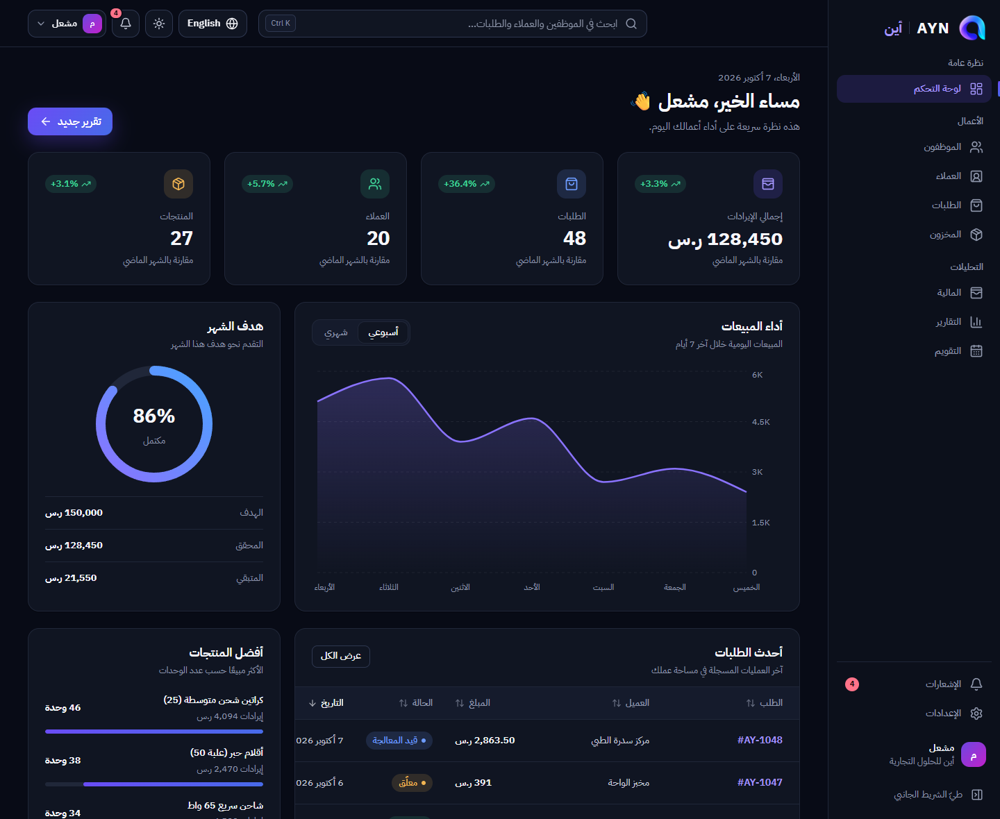
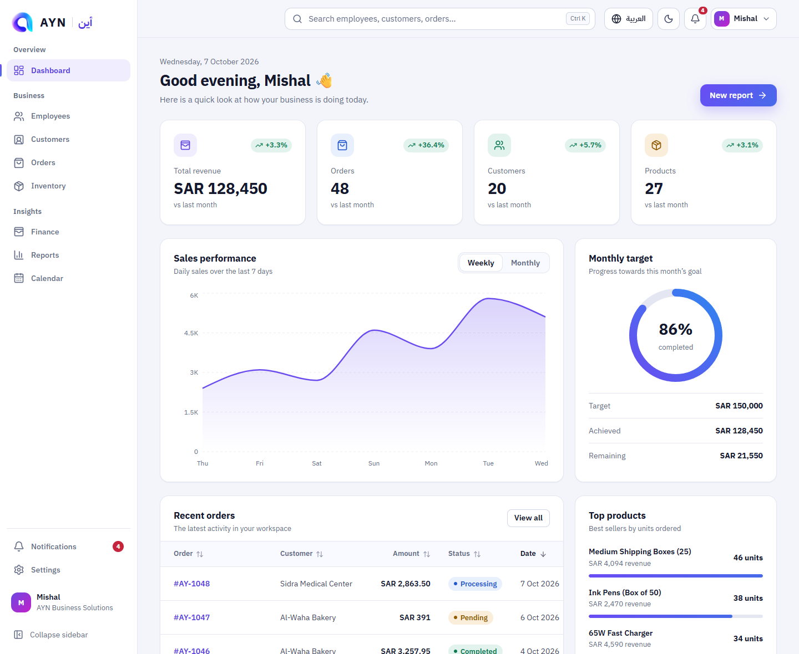
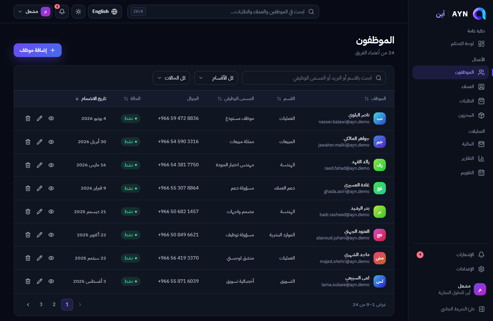
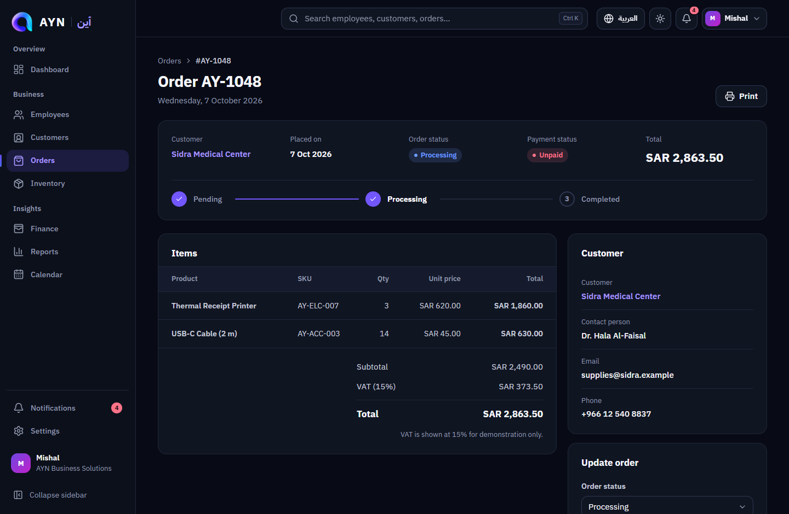
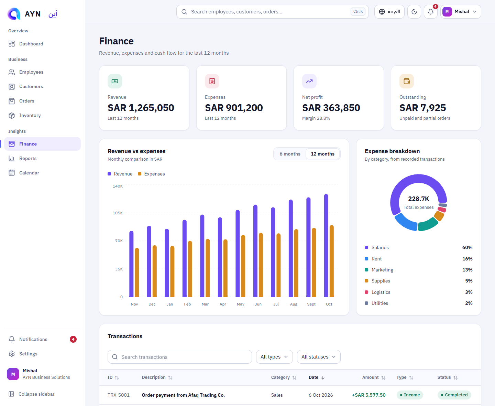
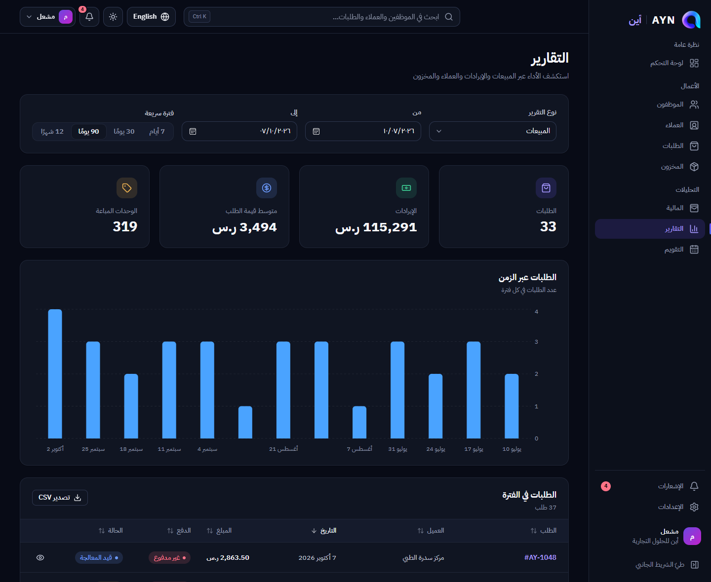
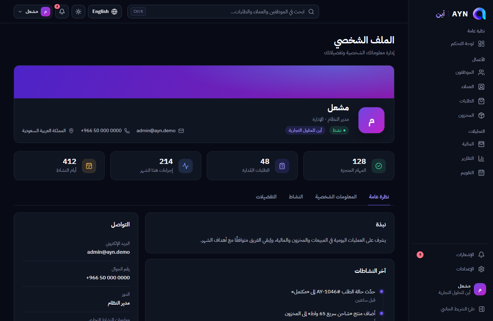
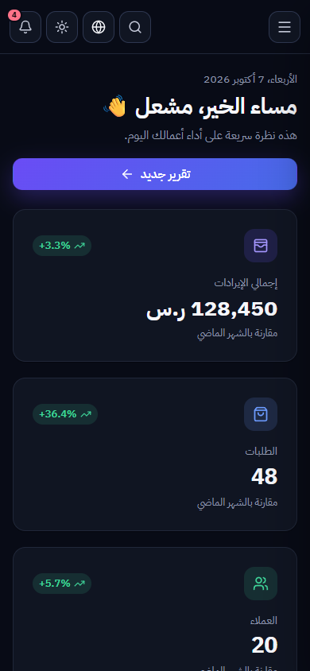

# AYN | أين

**كل أعمالك. في مكان واحد.**
**All your business. In one place.**

AYN is a bilingual (Arabic / English) business management dashboard built as a **front-end only portfolio project**. It covers employees, customers, orders, inventory, finance, reports, a calendar and notifications, with full RTL/LTR support and a dark-first design system that also ships a purpose-built light theme.

> AYN is a front-end portfolio project and is not affiliated with any existing company or commercial product.
> أين هو مشروع واجهات أمامية لأغراض العرض في الملف المهني، ولا يرتبط بأي شركة أو منتج تجاري قائم.

There is **no backend, no database and no real authentication**. All data is fictional mock data generated in TypeScript, held in React state and persisted to the browser's `localStorage`.

## Screenshots

| Dashboard — Arabic, dark | Dashboard — English, light |
| --- | --- |
|  |  |

| Employees | Order details |
| --- | --- |
|  |  |

| Finance | Reports |
| --- | --- |
|  |  |

| Profile | Mobile |
| --- | --- |
|  |  |

## Features

- **Routing** – client-side routes for every sidebar item, detail pages (`/employees/:id`, `/customers/:id`, `/orders/:id`), a protected-route layer, route-level code splitting and a branded 404.
- **Arabic + English** – one component system, a typed dictionary (a missing translation key is a compile error), real RTL ⇄ LTR switching with CSS logical properties, direction-aware icons, and Arabic-aware search (folds `أ إ آ`, `ة/ه`, `ى/ي`).
- **Dark / light / system theme** – design tokens in CSS variables, no flash of the wrong theme on load, charts follow the theme. Contrast of the token pairs is checked against WCAG AA.
- **Dashboard** – KPI cards, weekly/monthly sales chart, monthly-target ring, recent orders, top products (units, revenue, progress), recent activity and four quick actions.
- **Employees** – search, department/status filters, sortable columns, pagination, add/edit in a drawer, delete with confirmation, and a detail page with a hero, stats and Overview / Attendance / Tasks / Activity tabs.
- **Customers** – list with derived order counts and spending, add/edit, a detail page with stats, recent orders and notes you can add.
- **Orders** – search, status/payment/date filters, sorting, pagination, CSV export, **new order** (customer, line items, live VAT total, stock validation), and a detail page with a progress stepper, line items, 15 % VAT preview, status updates and print.
- **Inventory** – KPIs, filters, stock-level indicators, **add product** (SKU generated per category) and a "Restock" action. Orders deduct stock.
- **Finance** – revenue vs expenses chart, expense breakdown donut, filterable transactions table.
- **Reports** – sales, revenue, customers and inventory reports over a custom date range, with charts, tables and client-side CSV export.
- **Calendar** – month grid with events shown in the cells, create/edit/delete, selected-day panel and an upcoming list.
- **Notifications** – grouped by Today / Yesterday / Earlier, read/unread, type filters, mark all, delete, clear all, and a live unread badge in the topbar.
- **Search** – command-style topbar search across employees, customers, orders and products (`Ctrl/⌘ + K` or `/`), with arrow-key navigation.
- **Profile & Settings** – a profile with hero, stats and tabs; settings with a section list (appearance, language, notifications, business, rows per page, export/reset demo data).
- **UX details** – toasts, skeleton loaders shaped like the real content, empty and error states, an error boundary, accessible modals/drawers (focus trap, Escape, focus restore), `prefers-reduced-motion` support, and responsive tables that become labelled cards on phones.

## Tech stack

| Area | Choice |
| --- | --- |
| UI | React 19, TypeScript (strict) |
| Build | Vite 8 |
| Routing | React Router |
| Charts | Recharts (lazy-loaded) |
| Icons | Lucide React |
| Styling | Hand-written CSS with design tokens (no UI kit) |
| Fonts | IBM Plex Sans Arabic + IBM Plex Sans (Google Fonts) |
| Tooling | ESLint (typescript-eslint, react-hooks) |

State uses React Context (theme, language, auth demo, settings, data) — no state library was needed.

## Getting started

```bash
npm install
npm run dev        # start the dev server
npm run build      # type-check and build for production
npm run preview    # preview the production build
npm run lint       # run ESLint
npm run typecheck  # TypeScript only
```

Requires a Node.js version supported by Vite 8 (20.19+ or 22.12+).

## Demo credentials

| | |
| --- | --- |
| Email | `admin@ayn.demo` |
| Password | `12345678` |

This is a **demo login only**. Nothing is sent to a server and the "session" is a flag in browser storage — it is not secure and is not meant to be. Tick "Remember me" to keep it in `localStorage`; otherwise it lives in `sessionStorage`.

## Project structure

```
src/
  components/
    charts/      Area, bar, donut, ring and bar-list charts (+ lazy wrappers)
    feedback/    Toasts, skeletons, empty/error states, error boundary
    forms/       Text/select/textarea/checkbox/switch fields, search input
    layout/      App shell, sidebar, topbar, search command, popovers
    tables/      DataTable (sort + pagination + mobile cards), pagination
    ui/          Button, Card, Badge, Modal/Drawer, Tabs, Popover, …
  constants/     Storage keys, demo account, enums
  context/       Theme, i18n, auth (demo), settings, data, toast
  data/          Mock data files (employees, customers, products, orders, …)
  hooks/         Formatting, media queries, persistent state, titles, …
  i18n/          ar.ts, en.ts and typed translation keys
  pages/         One folder per feature
  router/        Routes and the protected-route wrapper
  styles/        tokens.css, base.css, ui.css, layout.css, pages.css
  types/         Shared TypeScript types
  utils/         Dates, formatting, CSV, validation, text helpers
design/          Original source artwork for the logo
docs/screenshots Images used in this README
```

## RTL / LTR

The language lives in `I18nContext` and is stored in `localStorage` (`ayn:lang`). Switching it updates `<html lang dir>`, so the same components render in both directions. Layout uses logical properties (`margin-inline-start`, `inset-inline-end`, …) instead of left/right. Direction-sensitive icons (back/next chevrons, sidebar collapse) swap automatically, emails/phones/IDs stay left-to-right inside Arabic text, and charts reverse their time axis in RTL.

## Dark / light mode

The theme (`light`, `dark` or `system`) is stored in `localStorage` (`ayn:theme`) and applied as `data-theme` on `<html>`. An inline script in `index.html` applies it before first paint. Dark is the default when nothing has been chosen.

## Responsive design

Verified at 1440, 1280, 1024, 768, 430 and 390 px in Arabic and English, dark and light. The sidebar is full-width on desktop, an icon rail on tablets and a drawer on phones. Tables scroll horizontally on tablets and become labelled cards on phones.

## Local data

Fictional Saudi-oriented data lives in `src/data/` and is generated on first load, then persisted under `ayn:data:v1`. Order totals, customer spending and dashboard counts are **derived** from the records, so they stay consistent when you change data (for example, creating an order also reduces stock). Some chart series (monthly revenue/expenses, weekly sales) are fixed sample numbers. **Settings → Data & demo** exports the data as JSON or resets it. Short simulated loading delays on first visit to list pages exist only to demonstrate skeleton states.

## Performance

Routes are code-split. Recharts (the largest dependency) is loaded on demand by the chart components, so pages render their shell, KPIs and tables first and the chart arrives behind a skeleton of the same height. Pages without charts never download it.

## Deploying

It is a static single-page app. `public/_redirects` (Netlify / Cloudflare Pages) and `vercel.json` rewrite deep links to `index.html`. For GitHub Pages you would need a hash router or a 404 fallback.

## Limitations

- No backend: data lives in one browser, and clearing site data resets it.
- Authentication is a demo only; do not store real information.
- VAT (15 %) and the "outstanding" figures are display logic for demonstration, not accounting.
- Native date/time inputs follow the operating system's locale, so their digits and order are chosen by the browser.
- AYN does **not** integrate with ZATCA, Absher, banks or any government service.
